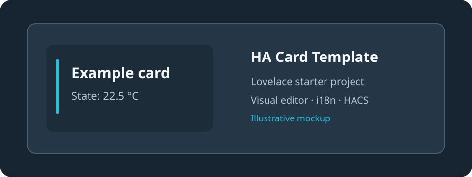

# HA Card Template



Reusable starter for Home Assistant Lovelace custom cards. **This repository is a development template, not a finished card for the HACS catalog.**

## Features
- Minimal working custom card and visual editor with entity selection, accent color and name visibility.
- Seven languages: English, Spanish, Portuguese, French, German, Italian and Dutch.
- Responsive styling using Home Assistant theme variables, HTML escaping and safe unavailable states.
- `hacs.json`, HACS validation workflow, Node.js syntax and smoke tests.
- `main` for reviewed code; `develop` for changes.

## Create a new card
1. Click **Use this template** (repository owner must enable **Template repository** in Settings).
2. Follow [New project checklist](docs/NEW_PROJECT.md) to rename the card, editor, resource and tests.
3. Replace sample functionality, customize the editor, document the configuration and test on Home Assistant.
4. Validate using `node --check ha-card-template.js` and `node --test tests/card.test.cjs`.
5. Publish a release and request inclusion in HACS **only for the finished, validated project**.

### Example configuration
```yaml
type: custom:ha-card-template
entity: sensor.example
accent: "#00a6d6"
show_name: true
```
Load `ha-card-template.js` as a Lovelace JavaScript module before using the example card. No user-specific entities or credentials are included.

## Scope
The editor and sample entity card are functional starting points, **not** a complete block-based card builder. Reuse architectural patterns rather than copying XPeng/Snapmaker hardware-specific behavior. A future universal card is a separate project.

---

# Plantilla de tarjetas Home Assistant

Base reutilizable para desarrollar tarjetas personalizadas de Lovelace. **Este repositorio es una plantilla de desarrollo, no una tarjeta terminada para el catálogo de HACS.**

## Funciones
- Tarjeta mínima y editor visual con selección de entidad, color de acento y visibilidad del nombre.
- Siete idiomas: inglés, español, portugués, francés, alemán, italiano y neerlandés.
- Diseño adaptable mediante variables de tema de Home Assistant, escape de HTML y gestión de estados no disponibles.
- Configuración `hacs.json`, validación HACS, pruebas sintácticas y pruebas básicas Node.js.
- Rama `main` para código revisado y `develop` para desarrollo.

## Crear una tarjeta nueva
1. Pulsa **Use this template** (el propietario debe activar **Template repository** en Settings).
2. Sigue la [lista de nuevo proyecto](docs/NEW_PROJECT.md) para renombrar tarjeta, editor, recurso y pruebas.
3. Sustituye la lógica de ejemplo, personaliza el editor, documenta las opciones y prueba en Home Assistant.
4. Ejecuta `node --check ha-card-template.js` y `node --test tests/card.test.cjs`.
5. Publica una Release y solicita la inclusión en HACS **solo cuando el proyecto nuevo esté terminado y validado**.

### Configuración de ejemplo
```yaml
type: custom:ha-card-template
entity: sensor.example
accent: "#00a6d6"
show_name: true
```
Antes de usarla, añade `ha-card-template.js` como recurso JavaScript de Lovelace. No se incluyen entidades ni credenciales personales.

## Alcance
El editor y la tarjeta de ejemplo son puntos de partida funcionales, **no** un constructor completo de bloques. La futura tarjeta universal será un proyecto independiente.
